# AgentOS — all agents and their LangGraph code

> **Generated** by `python scripts/gen_agent_docs.py` from the real agent catalog and graph files — don't edit by hand.
> Debug any of them step by step in **LangSmith**: Settings → Tracing (switch + API key), then open
> smith.langchain.com → project `agentos` — every run is named by its agent and shows each graph node, model
> call (prompt, answer, tokens, latency) and tool step. See `aap/tracing.py`. Improvement ideas: TODO.txt §0.

**37 agents** run on **20 LangGraph archetypes**. An archetype is a graph (nodes + edges); an agent is an archetype + prompt + tools + permissions (`aap/agents/prebuilt/catalog.py`).

## How a request flows
`Main Agent` (`aap/graphs/main.py`): load_context → classify_intent → plan_dag → run_step ⇉ (parallel agents) → collect → review → synthesize → remember (post-mortem). Each sub-agent below is its own compiled LangGraph, started by `aap/core/runtime.py::run_agent` (one traced run per agent step). During runs the Main Agent supervises (`aap/core/supervisor.py`).

## Graph archetypes (the LangGraph code)
| Archetype | Code | Nodes | Used by |
|---|---|---|---|
| `browser` | `aap/graphs/browser.py` | start, observe, decide, gate, act, verify, finalize | `browser_agent` |
| `builder` | `aap/graphs/builder.py` | understand_spec, inspect_registry, select_components, design, generate_prompts, generate_code, generate_tests, static_validation, run_tests, debug, security_review, approval_gate, register, smoke_run, report | `agent_builder` |
| `coding` | `aap/graphs/coding.py` | intake, repo_map, explore, plan, reproduce, implement, verify, diagnose, self_review, finalize | `coding_agent`, `python_agent`, `javascript_agent`, `react_agent`, `android_agent`, `database_agent` … |
| `competitive` | `aap/graphs/competitive.py` | parse_problem, pick_algorithm, solve, brute, stress_test, complexity, finalize | `competitive_programming_agent` |
| `composite` | `aap/graphs/composite.py` | plan, delegate, merge, review, finalize | `research_agent`, `software_dev_agent` |
| `data` | `aap/graphs/data.py` | ingest, profile, plan_analyses, compute, interpret, finalize | `data_analysis_agent` |
| `debug` | `aap/graphs/debug.py` | reproduce, hypothesize, investigate, fix, confirm, finalize | `debugging_agent` |
| `desktop` | `aap/graphs/browser.py` | start, observe, decide, gate, act, verify, finalize | `desktop_agent` |
| `generic` | `aap/graphs/generic.py` | prepare, plan, act, reflect, logic, synthesize, finalize | `registry_manager`, `memory_agent`, `scheduler_agent`, `github_agent`, `cleanup_agent` |
| `improve` | `aap/graphs/improve.py` | survey, compare, propose, suggest_build, finalize | `self_improvement_agent` |
| `main` | `aap/graphs/main.py` | load_context, classify_intent, respond, schedule_task, manage_agents, analyze_capabilities, ask_user, discover_agents, plan_dag, refine_plan, build_agent, risk_gate, dispatch, run_step, collect, review … | `main_agent` |
| `planner` | `aap/graphs/planner.py` | goal, constraints, decompose, schedule, risks, validate, finalize | `planning_agent` |
| `research` | `aap/graphs/research.py` | decompose, gather, extract, synthesize, critique, finalize | `web_research_agent`, `document_research_agent` |
| `review` | `aap/graphs/review.py` | collect, static_checks, review_dimension, rank, finalize | `code_review_agent` |
| `skillsmith` | `aap/graphs/toolsmith.py` | draft, check, save, finalize | `skill_writer_agent` |
| `teacher` | `aap/graphs/teacher.py` | assess_level, explain, examples, quiz, check_quiz, feedback | `teacher_agent`, `curriculum_agent`, `question_generator_agent` |
| `terminal` | `aap/graphs/terminal.py` | intake, operate, verify, finalize | `terminal_agent` |
| `testing` | `aap/graphs/testing.py` | discover, design_tests, write_tests, run, analyze, finalize | `testing_agent` |
| `toolsmith` | `aap/graphs/toolsmith.py` | design, write_code, test, create, finalize | `tool_builder_agent` |
| `writer` | `aap/graphs/writer.py` | outline, draft, critique, finalize | `documentation_agent`, `summarization_agent`, `writing_agent`, `writer_agent` |

## The graphs (Mermaid — paste into any viewer; GitHub/VS Code render them)

### `browser` — Web operator: open → observe (DOM snapshot) → decide → sensitive-action gate → act loop
Code: `aap/graphs/browser.py`

### `builder` — Agent Builder: spec → design → code → tests → validate/debug → approve → register
Code: `aap/graphs/builder.py`

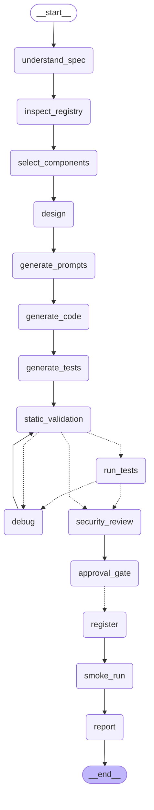

### `coding` — Codex-style engineer: repo map → explore → plan → (reproduce) → edit loop → verify ⇄ diagnose/fix → self-review → commit
Code: `aap/graphs/coding.py`

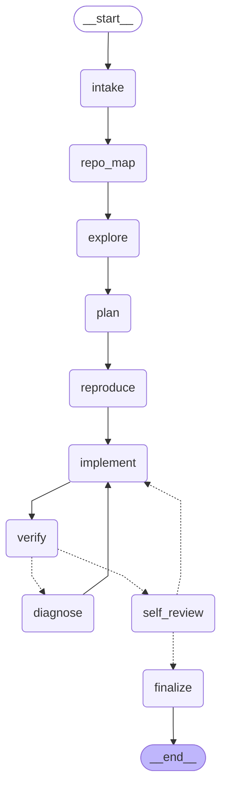

### `competitive` — Competitive programmer: parse → algorithm → solve → brute+generator → stress test ⇄ fix → complexity
Code: `aap/graphs/competitive.py`

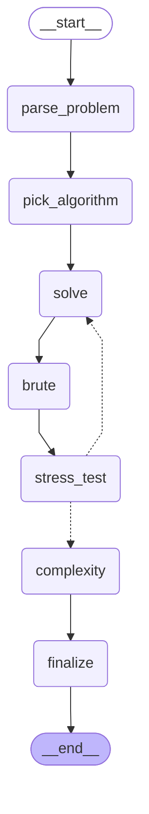

### `composite` — Team lead over sub-agents: plan → parallel delegation → merge → review/retry
Code: `aap/graphs/composite.py`

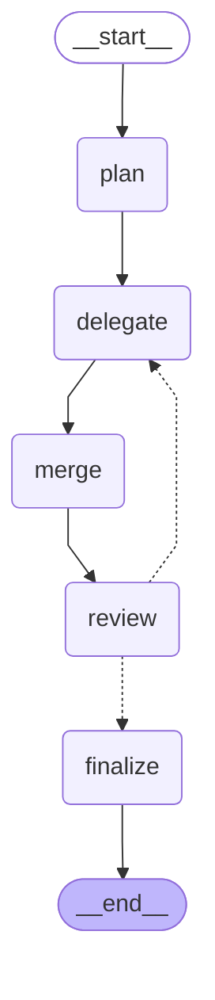

### `data` — Data analyst: ingest → profile → plan analyses → compute (sandboxed) ⇄ repair → interpret
Code: `aap/graphs/data.py`

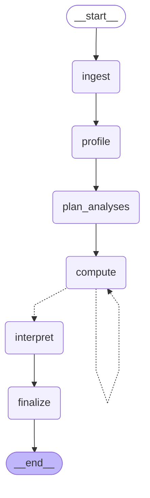

### `debug` — Debugger: reproduce → hypothesize → investigate loop → fix (delegates) → confirm ⇄
Code: `aap/graphs/debug.py`

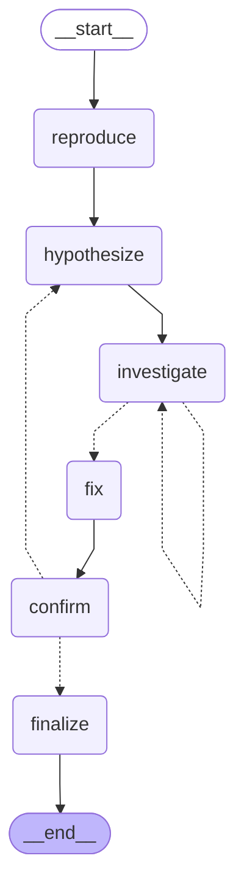

### `desktop` — Desktop operator via Host Bridge: observe UIA tree → decide → approve every action → act loop
Code: `aap/graphs/browser.py`

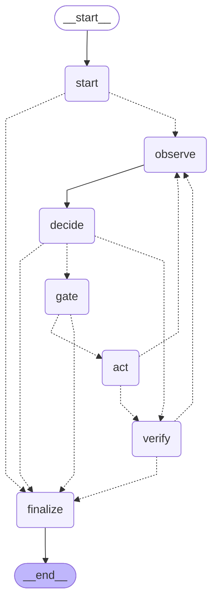

### `generic` — General worker: plan → tools/delegation loop → optional sandboxed logic → answer
Code: `aap/graphs/generic.py`

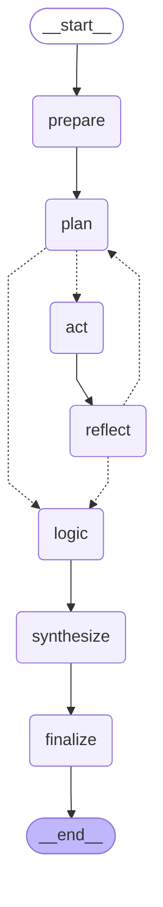

### `improve` — Self-improvement: survey similar products → compare → propose → approval-gated build suggestion
Code: `aap/graphs/improve.py`

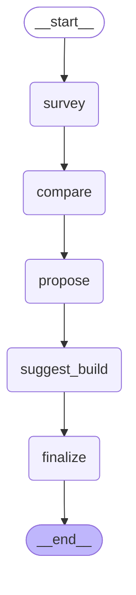

### `main` — Main Agent: intent → capabilities → registry discovery → DAG plan → (build missing agent) → parallel delegation → review loop → synthesis → 
Code: `aap/graphs/main.py`

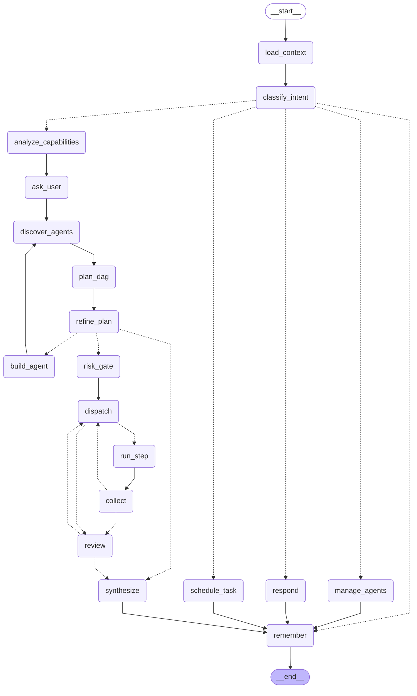

### `planner` — Planner: goal → constraints → tasks → schedule → risks → validate ⇄ repair
Code: `aap/graphs/planner.py`

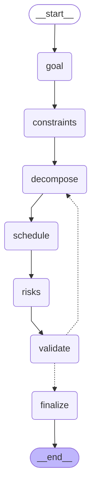

### `research` — Researcher: decompose → parallel search/fetch → extract claims → synthesize → critique/revise
Code: `aap/graphs/research.py`

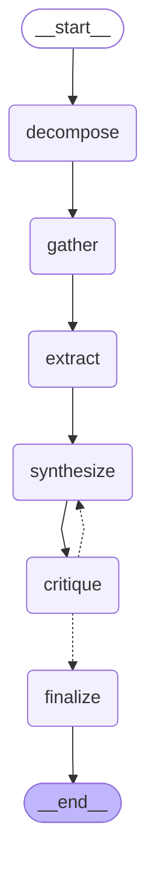

### `review` — Code reviewer: collect → static checks → per-dimension LLM review loop → rank
Code: `aap/graphs/review.py`

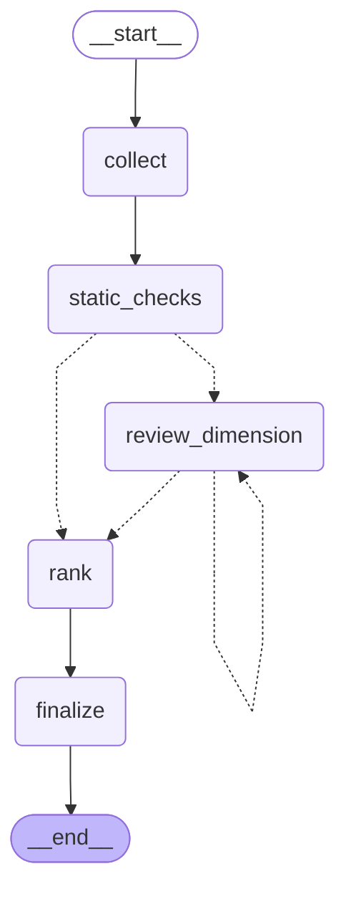

### `skillsmith` — Skill Writer: draft SKILL.md → check sections (fix) → save → verify it loads
Code: `aap/graphs/toolsmith.py`

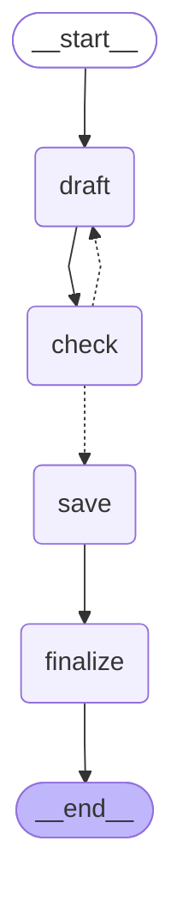

### `teacher` — Teacher/Curriculum/Question generator: assess → explain → examples → quiz ⇄ validate → lesson
Code: `aap/graphs/teacher.py`

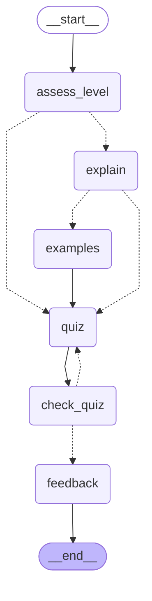

### `terminal` — Terminal operator: intake → ReAct shell/file loop (approval-gated) → verify → finalize
Code: `aap/graphs/terminal.py`

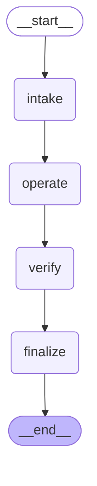

### `testing` — Tester: discover → design cases → write tests → run → analyze ⇄ repair broken tests
Code: `aap/graphs/testing.py`

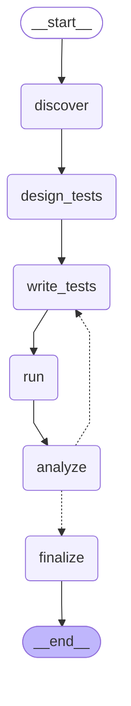

### `toolsmith` — Tool Builder: design → code → validate → sandbox self-test → fix → approve → register → verify
Code: `aap/graphs/toolsmith.py`

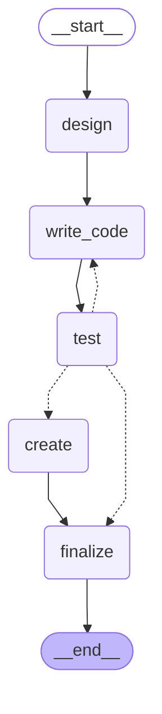

### `writer` — Writer: outline → draft → critique ⇄ revise
Code: `aap/graphs/writer.py`

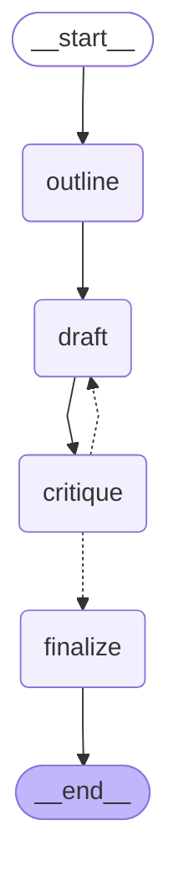

## Agents by category

### Automation
| Agent | Graph (code) | Tools | Delegates to |
|---|---|---|---|
| **Browser Agent** (`browser_agent`) — Operates a sandboxed Chrome (Playwright): navigates, clicks, fills forms, extracts info. C | `browser` · `aap/graphs/browser.py` | browser_open, browser_act, browser_snapshot, browser_screenshot, phone_update, page_text | — |
| **Cleanup Agent** (`cleanup_agent`) — Frees disk space safely: scans caches, old temp files, old AgentOS logs/screenshots and te | `generic` · `aap/graphs/generic.py` | disk_scan, disk_clean | — |
| **Computer Agent** (`desktop_agent`) — Uses your computer like a person: opens sites in your REAL Chrome profiles (where you're l | `desktop` · `aap/graphs/browser.py` | desktop_screenshot, desktop_tree, desktop_act, chrome_open_profile, desktop_wait_for, desktop_locate, phone_update | — |
| **Terminal Agent** (`terminal_agent`) — Runs terminal commands for you like a CLI coding assistant: inspects folders, runs scripts | `terminal` · `aap/graphs/terminal.py` | run_command, fs_list, fs_read, fs_write, fs_patch, search_code, skill_read | — |

### Development
| Agent | Graph (code) | Tools | Delegates to |
|---|---|---|---|
| **Android Agent** (`android_agent`) — Android/Kotlin specialist: Jetpack Compose, Gradle, app architecture. | `coding` · `aap/graphs/coding.py` | fs_list, fs_read, fs_write, fs_patch, search_code, run_command, git_status, git_diff, git_log, git_branch, git_commit, memory_recall, memory_remember, | debugging_agent |
| **C++ Agent** (`cpp_agent`) — C++ specialist: modern C++17/20, CMake, performance and correctness. | `coding` · `aap/graphs/coding.py` | fs_list, fs_read, fs_write, fs_patch, search_code, run_command, git_status, git_diff, git_log, git_branch, git_commit, memory_recall, memory_remember, | debugging_agent |
| **Database Agent** (`database_agent`) — SQL and database specialist: schemas, migrations, query tuning. | `coding` · `aap/graphs/coding.py` | fs_list, fs_read, fs_write, fs_patch, search_code, run_command, git_status, git_diff, git_log, git_branch, git_commit, memory_recall, memory_remember, | debugging_agent |
| **JavaScript Agent** (`javascript_agent`) — JavaScript/TypeScript and Node.js specialist. | `coding` · `aap/graphs/coding.py` | fs_list, fs_read, fs_write, fs_patch, search_code, run_command, git_status, git_diff, git_log, git_branch, git_commit, memory_recall, memory_remember, | debugging_agent |
| **Python Agent** (`python_agent`) — Python specialist: scripts, packages, FastAPI/Django, data tooling. | `coding` · `aap/graphs/coding.py` | fs_list, fs_read, fs_write, fs_patch, search_code, run_command, git_status, git_diff, git_log, git_branch, git_commit, memory_recall, memory_remember, | debugging_agent |
| **React Agent** (`react_agent`) — React + Vite front-end specialist: components, hooks, styling, state. | `coding` · `aap/graphs/coding.py` | fs_list, fs_read, fs_write, fs_patch, search_code, run_command, git_status, git_diff, git_log, git_branch, git_commit, memory_recall, memory_remember, | debugging_agent |
| **Software Dev Agent** (`software_dev_agent`) — Dev team lead: implements with the Coding Agent, then tests, reviews and documents the cha | `composite` · `aap/graphs/composite.py` | — | coding_agent, testing_agent, code_review_agent, documentation_agent |

### Education
| Agent | Graph (code) | Tools | Delegates to |
|---|---|---|---|
| **Curriculum Agent** (`curriculum_agent`) — Designs week-by-week curricula with objectives, practice and assessments. | `teacher` · `aap/graphs/teacher.py` | — | — |
| **Question Generator Agent** (`question_generator_agent`) — Generates validated multiple-choice quizzes and practice questions. | `teacher` · `aap/graphs/teacher.py` | — | — |
| **Teacher Agent** (`teacher_agent`) — Explains topics at the right level with worked examples and a quiz. | `teacher` · `aap/graphs/teacher.py` | — | — |

### Productivity
| Agent | Graph (code) | Tools | Delegates to |
|---|---|---|---|
| **Data Analysis Agent** (`data_analysis_agent`) — Profiles and analyses CSV/JSON/text data, computes statistics and explains insights. | `data` · `aap/graphs/data.py` | fs_read, data_profile, data_query, run_python | — |
| **Planning Agent** (`planning_agent`) — Turns goals into scheduled, risk-checked plans (study plans, project plans, weekly plans). | `planner` · `aap/graphs/planner.py` | memory_recall | — |
| **Prompt Writer** (`writer_agent`) — Polishes prompts and short texts (used by the Agent Builder for system prompts). | `writer` · `aap/graphs/writer.py` | — | — |
| **Writing Agent** (`writing_agent`) — Writes and edits emails, essays, posts and documents with a critique-and-revise loop. | `writer` · `aap/graphs/writer.py` | fs_read | — |

### Programming
| Agent | Graph (code) | Tools | Delegates to |
|---|---|---|---|
| **Code Review Agent** (`code_review_agent`) — Reviews code and diffs for correctness, security, performance and readability with ranked  | `review` · `aap/graphs/review.py` | fs_list, fs_read, search_code, run_command, skill_read | — |
| **Coding Agent** (`coding_agent`) — Autonomous Codex-style engineer: explores a repo, plans, edits files, runs tests, fixes an | `coding` · `aap/graphs/coding.py` | fs_list, fs_read, fs_write, fs_patch, search_code, run_command, git_status, git_diff, git_log, git_branch, git_commit, memory_recall, memory_remember, | debugging_agent |
| **Competitive Programming Agent** (`competitive_programming_agent`) — Solves algorithmic problems (Codeforces/CSES style) and stress-tests solutions against bru | `competitive` · `aap/graphs/competitive.py` | run_python | — |
| **Debugging Agent** (`debugging_agent`) — Reproduces bugs, forms and tests hypotheses, finds the root cause and gets it fixed. | `debug` · `aap/graphs/debug.py` | fs_list, fs_read, search_code, run_command, skill_read | coding_agent |
| **Documentation Agent** (`documentation_agent`) — Writes READMEs, API docs, docstrings and guides from code and context. | `writer` · `aap/graphs/writer.py` | fs_read, fs_list | — |
| **GitHub Agent** (`github_agent`) — Reads GitHub repositories, issues and READMEs, and works with local git history. | `generic` · `aap/graphs/generic.py` | web_fetch, web_search, git_status, git_log, git_diff, fs_list, fs_read, skill_read, http_request, download_file | — |
| **Testing Agent** (`testing_agent`) — Designs and writes unit/edge-case tests, runs them and reports coverage gaps. | `testing` · `aap/graphs/testing.py` | fs_list, fs_read, fs_write, search_code, run_command, skill_read | — |

### Research
| Agent | Graph (code) | Tools | Delegates to |
|---|---|---|---|
| **Document Research Agent** (`document_research_agent`) — Answers questions from local documents in your workspace or shared folders, with citations | `research` · `aap/graphs/research.py` | fs_read, fs_list, search_code, skill_read | — |
| **Research Agent** (`research_agent`) — Research team lead: combines web research, document research and summarisation. | `composite` · `aap/graphs/composite.py` | — | web_research_agent, document_research_agent, summarization_agent |
| **Summarization Agent** (`summarization_agent`) — Condenses long text, documents or reports into TL;DRs and key points. | `writer` · `aap/graphs/writer.py` | fs_read | — |
| **Web Research Agent** (`web_research_agent`) — Searches and reads the web, extracts claims and writes cited answers. | `research` · `aap/graphs/research.py` | web_search, web_fetch, http_request, download_file | — |

### System
| Agent | Graph (code) | Tools | Delegates to |
|---|---|---|---|
| **Agent Builder** (`agent_builder`) — AI software engineer that designs, codes, tests and registers new agents, reusing existing | `builder` · `aap/graphs/builder.py` | run_python, fs_read, fs_list, list_tools | tool_builder_agent, skill_writer_agent |
| **Main Agent** (`main_agent`) — Orchestrator: understands requests, plans across the agent library, delegates, reviews and | `main` · `aap/graphs/main.py` | memory_recall, memory_remember | — |
| **Memory Agent** (`memory_agent`) — Recalls and consolidates long-term memory: facts, preferences, past outcomes and project n | `generic` · `aap/graphs/generic.py` | memory_recall, memory_remember | — |
| **Registry Manager** (`registry_manager`) — Keeps the agent directory tidy: finds duplicates, describes agents, answers 'which agent c | `generic` · `aap/graphs/generic.py` | memory_recall | — |
| **Scheduler Agent** (`scheduler_agent`) — Turns recurring requests into scheduled jobs and summarises their results for the Home fee | `generic` · `aap/graphs/generic.py` | memory_recall | — |
| **Skill Writer** (`skill_writer_agent`) — Writes reusable SKILLs (SKILL.md: when to use, steps, do/don't, verification) from what wo | `skillsmith` · `aap/graphs/toolsmith.py` | create_skill, skill_read | — |
| **Tool Builder** (`tool_builder_agent`) — Creates NEW tools for the platform when agents need a capability no tool has: designs, cod | `toolsmith` · `aap/graphs/toolsmith.py` | create_tool, run_python, list_tools | — |

### System/Meta
| Agent | Graph (code) | Tools | Delegates to |
|---|---|---|---|
| **Self-Improvement Agent** (`self_improvement_agent`) — Studies similar products (OpenAI Dots, open-dots clones, OpenClaw, Hermes, Manus) and prop | `improve` · `aap/graphs/improve.py` | web_search, web_fetch, browser_open, browser_act, browser_snapshot, langsmith_runs, page_text, http_request, download_file | agent_builder |

## Tools every agent has
now, calc, chrome_profiles, chrome_profile_path, find_command, known_commands, fs_find (`aap/core/sdk.py::UNIVERSAL_TOOLS`); web agents also http_request / download_file; browser agents page_text; coding-type agents skill_read (Superpowers methodology).

## Improving an agent with LangSmith
1. Run the task (or a capability case from the Tests page).
2. LangSmith → project `agentos` → filter by tag `agent:<id>` or metadata `run_id` (shown in the run URL).
3. Open the slow/failed node: read the exact prompt and answer, fix the prompt/graph in the file listed above.
4. Re-run the case; the nightly self-test scores it (TODO P3/P4 link traces + datasets).
